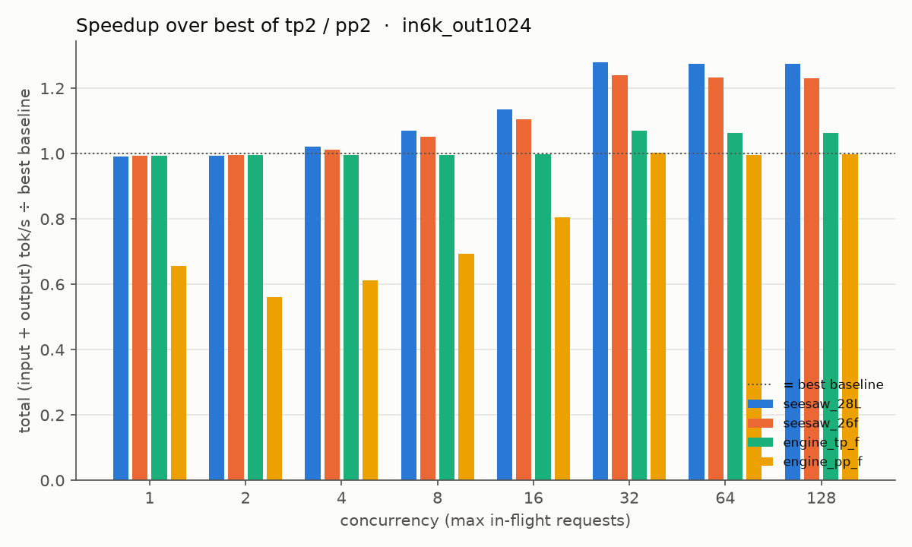
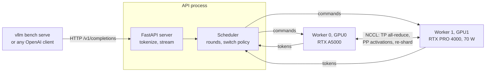

# Seesaw on two heterogeneous GPUs

An LLM inference engine that runs **prefill with pipeline parallelism (PP) and decode with
tensor parallelism (TP)**, re-sharding the model's weights and KV cache between the two GPUs
each time it changes phase. It reimplements the core idea of *Seesaw: High-throughput LLM
Inference via Model Re-sharding* ([arXiv 2503.06433](https://arxiv.org/abs/2503.06433)) for
Gemma 4 12B (bf16) on two 24 GB GPUs of different speeds, and compares it against vLLM's
TP2 and PP2 on the same machine and the same benchmark client.

CS5903 Distributed AI Training, project 24, group 25: Devansh Garg (CS25MTECH12022).

## Status

| | |
|---|---|
| **Working** | Seesaw mode (PP prefill → re-shard → TP decode) with a 28/20 layer split, KV parking and a split embedding; the same engine fixed in TP or PP as controls; OpenAI-compatible `/v1/completions` (streaming and not); full benchmark sweeps of all configurations with 0 failed requests |
| **Partial** | Sampling is greedy or the model's default; one model (Gemma 4 12B, text only); exactly two GPUs |
| **Not implemented** | The paper's tiered CPU KV buffer (needs ≥ 64 GB host RAM; this machine has 15 GB); continuous batching (the engine runs rounds); chat completions endpoint |

**Result.** Total (input + output) tokens per second, input 6144 tokens, every level 0 failed
requests. Seesaw is the final 28/20 configuration; the full tables, including our own TP and
PP modes, are in [`results/`](results/README.md).

| Concurrency | 1 | 2 | 4 | 8 | 16 | 32 | 64 | 128 |
|---|---|---|---|---|---|---|---|---|
| 512 out: vLLM TP2 | 338 | 598 | 982 | 1426 | 1843 | 2091 | 2116 | 2116 |
| 512 out: **Seesaw** | 333 | 588 | 1014 | 1582 | 2205 | 2751 | 2772 | 2770 |
| ratio | 0.98 | 0.98 | 1.03 | 1.11 | 1.20 | **1.32** | **1.31** | **1.31** |
| 1024 out: vLLM TP2 | 192 | 356 | 625 | 991 | 1398 | 1661 | 1681 | 1681 |
| 1024 out: **Seesaw** | 190 | 353 | 639 | 1060 | 1587 | 2125 | 2144 | 2142 |
| ratio | 0.99 | 0.99 | 1.02 | 1.07 | 1.14 | **1.28** | **1.28** | **1.27** |

vLLM TP2 is the stronger of the two vLLM baselines at every level. Median time to first
token is worse than vLLM's up to c = 32 (13.4 s vs 5.0 s at c = 16) because requests wait
for the next round; see [Limitations](#limitations).



## How it works



- **One round:** the scheduler admits waiting requests into up to 32 KV slots. With 4 or
  more, both GPUs switch to PP (GPU0 layers 0 to 27, GPU1 layers 28 to 47) and prefill
  them; then they switch to TP (every layer split in two) and decode the whole batch to
  the end. With fewer than 4 everything stays in TP.
- **Half-tensors:** every layer's weights and KV are stored as two TP halves in both
  layouts, so a switch only swaps whole tensors between the GPUs over NCCL (with 32
  sequences: 0.7 s into PP, 1.2 s back to TP).
- **Lean GPU0:** in PP, GPU0 runs 8 more layers than GPU1. Their second-half KV is sent
  ("parked") to GPU1, where TP needs it anyway, as each prefill ends, and GPU0 keeps half
  of the embedding table. This is what lets 28/20 hold 32 sequences.
- **Kernels:** attention uses vLLM's Triton kernels; the rest of the decode step is fused
  with torch.compile and captured in CUDA graphs.

The design decisions, the alternatives and the evidence for each are in
[`docs/Architecture_Decision_Records.md`](docs/Architecture_Decision_Records.md).

## Repository layout

| Path | Contents |
|---|---|
| [`seesaw/`](seesaw/) | The engine. `server.py` (HTTP API), `scheduler.py` (rounds and switch policy), `worker.py` (one process per GPU), `engine.py` (prefill, decode, TP/PP), `reshard.py` (weight and KV exchange, parking), `kv_cache.py` (slots and block tables), `model/` (Gemma 4 on half-tensors), `loader.py`, `config.py`, `decode_graph.py` (CUDA graphs) |
| [`tests/`](tests/) | Correctness tests: scheduler (CPU), layers vs transformers, full model vs vLLM, PP decode, re-sharding, end to end over HTTP. `golden/golden.json` holds vLLM's reference outputs |
| [`bench/`](bench/) | Engine-level measurements: decode step and prefill speed, memory per GPU, NCCL link speed, decode profile, golden capture |
| [`scripts/`](scripts/) | Start the engine or a vLLM baseline on the GPU machine; sync code to it |
| [`evaluation/`](evaluation/) | Benchmark client setup, the concurrency sweep, the multi-config driver, plots and tables |
| [`results/`](results/) | Raw results of every run in the report, GPU logs, plots ([index](results/README.md)) |
| [`docs/`](docs/) | Architecture decision records |
| [`requirements/`](requirements/) | Pinned dependencies for the GPU machine and the benchmark client |

## Requirements

- **GPUs:** two CUDA GPUs with 24 GB each. Developed and measured on an RTX A5000 (SM 8.6)
  as GPU0 and an RTX PRO 4000 Blackwell (SM 12.0, 70 W cap) as GPU1, on different sockets
  with no peer-to-peer access. The engine uses `CUDA_DEVICE_ORDER=PCI_BUS_ID`; GPU0 must
  be the faster card because it takes 28 layers in PP. Other cards with 24 GB should work
  but are untested.
- **Host:** Linux, about 15 GB RAM is enough (weights are loaded slice by slice), `tmux`, `uv`.
- **Model:** [`google/gemma-4-12B-it`](https://huggingface.co/google/gemma-4-12B-it) is gated:
  accept its licence on Hugging Face and use a token with access. The weights (24 GB) are
  not in this repository.
- **Software:** Python 3.12, vLLM 0.31.0, PyTorch 2.13 (CUDA 13.0 wheels), pinned in
  [`requirements/box.txt`](requirements/box.txt). The benchmark client uses Python 3.11 and
  [`requirements/client.txt`](requirements/client.txt).
- No database, migrations or external services. No secrets are needed apart from the
  Hugging Face token.

## Setup

**Configuration.** Copy `.env.example` to `.env` and fill it in:

| Variable | Used by | Meaning |
|---|---|---|
| `BASE_URL` | evaluation scripts, e2e test | The server as the client reaches it, e.g. `http://gpu-box:8000` |
| `BOX_HOST` | `scripts/sync-box.sh`, `evaluation/run-sweeps.sh` | SSH host of the GPU machine; empty if the client runs on it |
| `BOX_DIR` | the same | This repository's path on the GPU machine, relative to home |
| `HF_TOKEN` | model and tokenizer download | Hugging Face token with access to Gemma 4 |

**GPU machine** (from the repository root):

```bash
uv venv --python 3.12 .venv
uv pip install --python .venv -r requirements/box.txt
source .venv/bin/activate
export HF_TOKEN=...                          # or put it in .env
hf download google/gemma-4-12B-it            # 24 GB, into the Hugging Face cache
python bench/nccl_check.py                   # both GPUs talk over NCCL: prints link speeds
```

**Benchmark client** (the GPU machine itself or another Linux machine):

```bash
evaluation/setup-bench-client.sh             # .venv-bench, tokenizer download, server check
```

## Run

```bash
scripts/serve-engine.sh seesaw --split 28    # in tmux session "engine"; ready in about 2 minutes
tail -f $(ls -t logs/engine_seesaw_*.log | head -1)   # newest log: "workers ready", then one line per round
```

The flags of `python -m seesaw.server` are `--mode seesaw|tp|pp`, `--split` (layers on GPU0
in PP, default 24), `--slots` (32), `--max-len` (7200 tokens, prompt + output),
`--chunk` (2048, prefill chunk), `--min-switch-batch` (4), `--port` (8000).

Example request. The model is instruction-tuned, so the prompt uses Gemma 4's chat format
(without it, greedy decoding gives junk, from vLLM as well):

```bash
curl -s localhost:8000/v1/completions -H 'Content-Type: application/json' -d '{
  "model": "gemma4-12b", "max_tokens": 12, "temperature": 0,
  "prompt": "<bos><|turn>user\nWhich planet in our solar system is known as the Red Planet?<turn|>\n<|turn>model\n<|channel>thought\n<channel|>"}'
```

Expected `text`: `The planet known as the Red Planet is **Mars**.<turn|>` with
`usage.completion_tokens` 12 (vLLM gives the same sentence; it stops at the end-of-turn
token, which this engine does not, see Limitations). Each round appears in the engine log:

```
round B=1 layout=tp prefill 0.25s switch 0.00s (to PP 0.00s, to TP 0.00s) decode 0.36s
round B=32 layout=pp prefill 44.53s switch 1.89s (to PP 0.66s, to TP 1.23s) decode 30.11s
```

The first is a single request (no switch); the second a benchmark round of 32 requests of
6144 + 512 tokens.

Stop: `tmux kill-session -t engine`. The vLLM baselines start with
`CONFIG=tp2 scripts/serve-vllm.sh` or `CONFIG=pp2 scripts/serve-vllm.sh` (foreground, Ctrl+C
to stop); stop one server before starting another, since each needs both GPUs.

## Tests

| Command | Where | Expected |
|---|---|---|
| `python tests/test_scheduler.py` | anywhere, no GPU | `PASS (7 tests)`: TP below 4 requests, PP→TP at 4 or more, more requests than slots, `max_tokens=1`, TP and PP modes never switch |
| `tests/run_gpu_tests.sh` | GPU machine, GPUs free | Every line `PASS` (about 18 minutes): layers vs transformers on both GPUs, full model in TP, PP and lean TP vs vLLM's greedy outputs, pipelined PP decode, PP→TP→PP re-sharding at 24/24, 26/22 and 28/20 lean |
| `python tests/test_server_e2e.py` | client, server running | `PASS` (about 20 s): health and model list, an unseen prompt answered correctly, streaming equals non-streaming, `max_tokens=1`, malformed and over-long requests refused with 400, 40 concurrent requests (more than the 32 slots) all complete |

The model tests are teacher-forced on vLLM's tokens and compare log-probabilities, because
bf16 rounding can flip near-ties and one flip would change every later token. They pass
when the mean error per case stays below a threshold; the printed numbers show the margin.
`tests/golden/golden.json` was captured from vLLM TP2 with `bench/capture_golden.py`.
Outputs of the final runs: [`results/tests/`](results/tests/).

## Reproduce the evaluation

Each configuration is one sweep over concurrency 1 to 128 at 512 and 1024 output tokens
(5 to 6 hours of benchmark time per configuration). Results go to `results/<config>/`, and a level that already
has a complete result is skipped, so an interrupted sweep resumes where it stopped.

```bash
# Baselines: start the server on the GPU machine, then run the client
CONFIG=tp2 scripts/serve-vllm.sh             # GPU machine
CONFIG=tp2 evaluation/vllm-bench.sh          # client
CONFIG=pp2 scripts/serve-vllm.sh
CONFIG=pp2 evaluation/vllm-bench.sh

# Seesaw and the same-engine controls, started and stopped automatically
evaluation/run-sweeps.sh "seesaw_28L|seesaw --split 28|1 2 4 8 16 32 64 128" \
                         "engine_tp_f|tp|1 2 4 8 16 32 64 128" \
                         "engine_pp_f|pp --split 26|1 2 4 8 16 32 64 128"

# Tables and plots
python evaluation/make_tables.py
python evaluation/make_tables.py --metric ttft
```

The plot command is in [`results/README.md`](results/README.md). The workload is
`vllm bench serve --dataset-name random --random-range-ratio 0 --ignore-eos` with its default
seed 0, so every run sends the same token ids.

## Demo path

1. `scripts/serve-engine.sh seesaw --split 28` and
   `tail -f $(ls -t logs/engine_seesaw_*.log | head -1) | grep --line-buffered -E "workers ready|round"`.
2. The example request above: one request, `layout=tp` in the log (no switch).
3. `python tests/test_server_e2e.py`: the 40-request burst shows `layout=pp` rounds with
   their prefill, switch and decode times.
4. `CONFIG=demo LEVELS=32 TESTS=in6k_out512 PROMPTS_MULT=1 evaluation/vllm-bench.sh`: one
   round of 32 benchmark requests (about 2 minutes); the full level with 320 requests is
   `results/seesaw_28L/in6k_out512_n32.json`.

## Operations and troubleshooting

- **Logs:** engine `logs/engine_<mode>_<time>.log`; vLLM `logs/serve_<config>_<time>.log`;
  GPU tests `logs/tests_<time>.log`. A healthy engine log shows one `round` line per round
  and no `Traceback`.
- **Reset:** stop the server (`tmux kill-session -t engine`) and start it again; the engine
  keeps no state on disk.
- **"GPU memory is held by"** on start: a previous server or test is still running. Check
  `nvidia-smi`, stop it, and start again.
- **`expandable_segments: memory mapping failed` warnings:** expected in Seesaw mode, where
  GPU0 runs within about 0.8 GB of full; the allocator retries and no request fails.
- **NCCL hangs or `/dev/shm/nccl-` errors:** the engine sets `NCCL_CUMEM_ENABLE=0` and
  `NCCL_CUMEM_HOST_ENABLE=0`, needed when the GPUs have no peer access. Check with
  `python bench/nccl_check.py`.
- **Benchmark level aborted with "server stopped answering /health":** the client lost the
  server (on our runs, a network drop between client and GPU machine). Rerun the same
  command; it resumes at that level.
- **Out of memory at startup with another split:** `python bench/mem_breakdown.py <split> 32 lean`
  shows the free memory per GPU after the switch to PP.

## Limitations

- Rounds, not continuous batching: a request arriving during decode waits for the round to
  end, so median TTFT is worse than vLLM's up to c = 32.
- The benchmark uses fixed output lengths, where all sequences of a round finish together.
  With variable lengths, finished sequences would leave slots idle until the round ends;
  this has not been measured.
- No CPU KV buffer, so one switch serves at most 32 sequences. The paper's buffer needs far
  more host RAM than the 15 GB available.
- Specific to Gemma 4 12B and to two GPUs; the 28/20 split is tuned for this GPU pair.
- Below 4 concurrent requests Seesaw is the TP mode (0.98 to 0.99 of vLLM TP2).
- Every request generates exactly `max_tokens`: end-of-sequence and stop strings are ignored
  (as the benchmark's `--ignore-eos` asks), and a client that disconnects does not cancel
  its sequence.
- Free-running greedy output matches vLLM token for token on 1 of the 6 reference prompts;
  on the others it diverges at the first near-tie, as the 0 to 4 flips in the
  teacher-forced tests predict. After the two long prompts even the first token differs.
  This is attributed to bf16 rounding (our own output moves as much when only the prefill
  chunk size changes), not proven.

Open work is tracked in the [issues](https://github.com/garg-tech/seesaw/issues).

## Acknowledgements

The Seesaw design is from Su et al., arXiv 2503.06433. Attention and KV-cache writes use
vLLM's Triton kernels and its NCCL wrapper as a library (vLLM, Apache-2.0); the model
follows vLLM's and transformers' Gemma 4 implementations. Gemma 4 weights are under the
Gemma terms of use and are not redistributed here. The benchmark client is
`vllm bench serve`. Code in this repository was written with the help of an AI coding
assistant (Claude Code); correctness is checked by the tests above against vLLM's outputs,
and every reported number comes from the raw files in `results/`.
